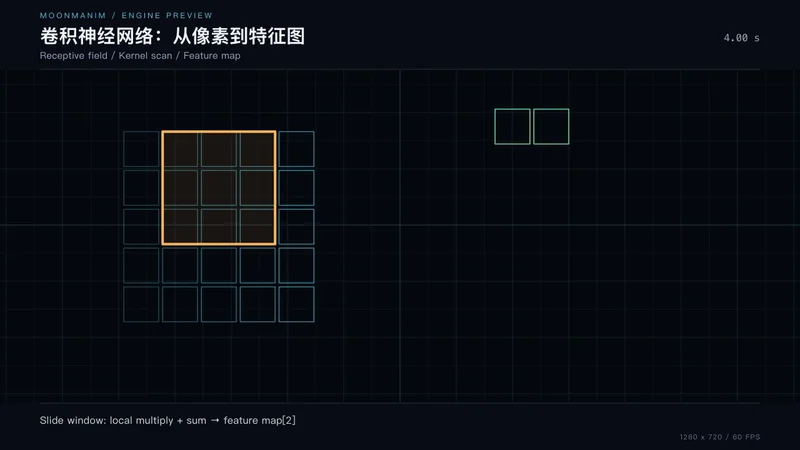
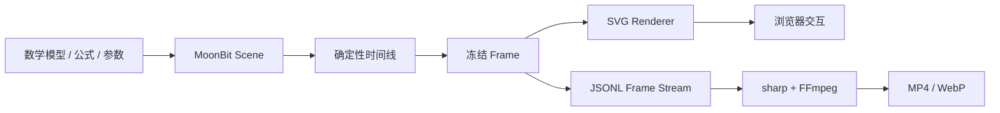

<div align="center">

# MoonManim

### 用 MoonBit 把数学变成可以运行、检查和探索的过程

一个面向数学教学与科学可视化的程序化动画引擎：同一份场景描述，同时生成可交互网页、逐帧 SVG 和离线视频。

[在线展示站](https://noahzhao.github.io/moonbit-Manim/) · [能力矩阵](https://noahzhao.github.io/moonbit-Manim/features.html) · [架构说明](docs/architecture.zh-CN.md) · [MIT License](LICENSE)

<br>



<sub>同一个场景可以解释几何、导数，也可以解释 CNN 的感受野与特征图。</sub>

</div>

## 为什么这个项目有意义

静态图片能展示结论，却很难展示“结论是怎样产生的”。数学课堂、算法课程和科研报告真正需要的，是一条可以暂停、跳转、修改参数并重新验证的过程。

MoonManim 把这条过程保存成有结构的数据：几何对象、公式符号、参数轨道、动画时间和渲染输出彼此分离。结果不再是一段只能播放的媒体，而是可以继续探索的计算模型。

这也是 MoonManim 与 Manim 的核心差异：项目不追求 Python API 兼容层，而是以 MoonBit 为第一语言，重新设计一个静态类型、跨后端、可验证的数学动画核心。

## 先看结果

| 入口 | 读者可以看到什么 |
| --- | --- |
| [交互实验](https://noahzhao.github.io/moonbit-Manim/#playground) | 六个可以直接拖动参数的数学项目：矩阵、贝塞尔曲线、勾股定理、割线与切线、利萨如曲线、轮廓变形 |
| [能力矩阵](https://noahzhao.github.io/moonbit-Manim/features.html) | 20 项能力的实现状态、证据入口和当前边界 |
| [CNN 卷积演示](https://noahzhao.github.io/moonbit-Manim/assets/demos/cnn.mp4) | 5×5 输入网格、3×3 卷积核、感受野滑动和 3×3 特征图，10.45 秒无声视频 |
| [CNN 激活与池化](https://noahzhao.github.io/moonbit-Manim/assets/demos/cnn-pooling.mp4) | 显示有符号响应经 ReLU 归零，再由 2×2 最大池化生成特征图 |
| [割线与切线课程](https://noahzhao.github.io/moonbit-Manim/?scene=tangent#playground) | 六个讲解章节；暂停视频后可以接管参数，自由探索，再回到同一时间线 |

站点是静态 GitHub Pages，不需要登录，也不需要在浏览器中安装 MoonBit。所有展示资源都已经提交到 `site/`，打开网页即可体验。

## 三项核心创新

### 1. 一份课程，两个出口：视频与交互共享同一时间线

割线课程不是“先做视频、再手写一个网页版本”。课程模型中的参数、章节、目标状态和时间边界由 MoonBit 定义：

```text
Lesson + ValueTracker + Updater
              │
              ├── 浏览器：实时 SVG、参数拖动、章节跳转
              └── 视频：逐帧求值、字幕/书签、H.264 导出
```

因此，视频第 12 秒对应网页中的同一个参数状态；修订课程时，不需要维护两套运动逻辑。这是内容生产和数字教材都需要的“单一事实来源”。

### 2. 数学对象不是像素：公式和几何拥有语义身份

公式由可拆分的 TeX 部分组成，几何由路径、轮廓和控制点组成。公式项可以按语义 key 匹配，保留对象身份后移动、变色和转场；路径可以按弧长测量、截取和变形。

这让动画能够解释“哪个符号变成了哪个符号”“哪个局部区域产生了这个特征”，而不是只把上一张图片淡出、下一张图片淡入。

对应实现：[Formula](src/text/formula.mbt) · [PathMeasure](src/geometry/measure.mbt) · [PathMorph](src/geometry/path.mbt)

### 3. 动态几何有可检查的执行契约

`ValueTracker` 和 `Updater` 通过显式依赖构成有向无环图。每一帧按固定顺序执行：

```text
采样动画 → 更新声明过依赖的几何 → 渲染冻结 Frame
```

场景会拒绝跨场景句柄、循环依赖、并行动画冲突和非有限数值；时间使用有理帧率向上量化。结果可以做逐帧比较，网页和原生检查点已经用 1e-7 像素容差进行一致性验证。

对应实现：[Scene](src/scene/scene.mbt) · [Updater](src/scene/updater.mbt) · [FrameRate](src/timeline/clock.mbt)

## 从几何到算法：一个 CNN 示例

CNN 不是一个与引擎无关的插图，而是用相同的场景运行器生成的算法过程：

1. 显示 5×5 输入激活图；
2. 把 3×3 kernel 放到局部感受野；
3. 沿行列滑动窗口；
4. 每次局部乘加完成后，点亮输出特征图对应位置。

```text
输入激活图       局部感受野 / 卷积核        输出特征图
┌─────────┐          ┌───┐                  ┌─────┐
│ 5 × 5   │   ───→   │3×3│   ───→           │ 3×3 │
└─────────┘          └───┘                  └─────┘
```

场景源码在 [`src/cmd/videos/scenes.mbt`](src/cmd/videos/scenes.mbt)，生成命令为：

```sh
npm run cnn
```

这个案例说明引擎的用途不局限于几何证明：只要过程可以被表达为对象、状态和时间，就能制作成可观察的算法讲解。

## 当前能力快照

| 主题 | 已验证能力 | 状态 |
| --- | --- | --- |
| 几何 | 三次贝塞尔路径、弧长测量、部分路径、坐标平面、函数采样、轮廓变形 | 已验证 |
| 动画 | Create、Write、Transform、Shift、Rotate、Fade、ApplyAffine、并行与错峰编排 | 已验证 |
| 数学表达 | TeX → 矢量路径、语义公式项、公式转场、教学场景和面积证明 | 已验证 |
| 运行时 | Native、JavaScript、Wasm、Wasm-GC、SVG 后端、流式视频导出 | 已验证 |
| 课程 | 章节时间线、参数目标、视频接续、字幕与旁白轨道 | 部分已验证 |
| 下一层架构 | 数学语义场景图、Scene IR、增量求值、可替换 TTS Provider | 实验中 / 计划中 |

完整状态、源码入口和证据链接见[能力矩阵](https://noahzhao.github.io/moonbit-Manim/features.html)。

## 架构：同一核心，多个输出



核心依赖方向保持单向：

```text
math → geometry → mobject → animation
                         ↘ scene → timeline / render
                         ↘ text / teaching / lesson
```

渲染器只接收冻结的 `Frame`，不依赖浏览器 DOM，也不持有原生图形指针。浏览器和视频导出器因此可以共享同一个场景模型，同时保持各自的输出策略。

## 五分钟运行一个场景

已验证工具链：Moon 0.1.20261104、moonc v0.10.20+65efd5b93、Node.js 22+、FFmpeg（视频导出需要）。

```sh
# 1. 获取仓库
git clone https://github.com/NoahZhao/moonbit-Manim.git
cd moonbit-Manim

# 2. 安装构建脚本依赖
npm ci

# 3. 检查和测试 MoonBit 核心
moon check --target all --deny-warn
moon test --target all --deny-warn

# 4. 生成一个 SVG 基础场景
mkdir -p output
moon run src/cmd/demo --target native --deny-warn > output/foundation.svg

# 5. 生成 CNN 视频
npm run cnn
```

常用命令：

```sh
make check             # 格式与全目标检查
make test              # 调试 / native release 测试
npm run site:build     # 编译浏览器 MoonBit 引擎并更新 site/assets/engine.js
npm run site:check     # 检查网页入口、引擎输出和所有静态资源
npm run site:serve     # 本地预览 GitHub Pages
```

如果只想看线上效果，直接打开[展示站](https://noahzhao.github.io/moonbit-Manim/)即可。

## 用代码写一个动画

下面的场景不依赖浏览器，也不依赖 Python。`Scene` 负责时间，`ObjectState` 保存对象状态，Renderer 决定输出格式。

```moonbit
fn main raise {
  let camera = @render.Camera2D::new()
  let renderer = @render.SvgRenderer::new(camera, (index, svg) => {
    if index == 90L { println(svg) }
  })
  let scene = @scene.Scene::new(renderer)
  let square = scene.add(
    @mobject.ObjectState::shape(@geometry.square(2.0)),
  )
  let circle = @mobject.ObjectState::shape(
    @geometry.circle(1.0),
    style={
      ..@mobject.Style::default(),
      stroke: @mobject.Color::pink(),
      fill: @mobject.Color::pink(),
      fill_opacity: 0.3,
    },
  )
  scene.play([@animation.create(square)], duration=1.0)
  scene.play([@animation.transform(square, circle)], duration=1.0)
  scene.play([@animation.fade_out(square)], duration=0.5)
}
```

## 质量与可复现性

- **86 项 MoonBit 测试**：覆盖几何精度、弧长、对象生命周期、动画时钟、Updater 依赖、公式项匹配、课程边界和探索隔离。
- **跨端检查**：原生适配器与已提交的浏览器 JavaScript 在课程检查点比较章节、参数和 SVG 坐标。
- **逐帧导出检查**：视频导出器检查帧序号、帧数、尺寸、结束记录和编码器退出状态。
- **静态部署**：GitHub Pages 直接发布已编译资产，不要求线上安装 MoonBit；每次 `site/` 变更由 GitHub Actions 检查后部署。

运行完整检查：

```sh
moon fmt --check
moon test --target all --deny-warn
moon test --target native --release --deny-warn
npm run site:check
npm run lesson:check
```

## 项目结构

```text
src/math/          Vec3、Affine2、有限值工具
src/geometry/      贝塞尔路径、边界、弧长、部分路径、变形
src/mobject/       Color、Style、ObjectState、Store
src/animation/     动画描述符、缓动、无状态采样
src/scene/         场景运行器、ValueTracker、Updater、依赖排序
src/text/          TeX 资产、公式布局、语义项匹配
src/lesson/        课程参数、章节、绝对时间采样
src/cmd/videos/    基础视频与 CNN 算法演示
src/cmd/dynamics/  割线、切线和动态几何课程
src/cmd/web/       浏览器交互与 JavaScript 桥接
site/              GitHub Pages 静态站点与已编译资源
scripts/           TeX、视频、旁白和站点构建工具
docs/              架构、课程、网站和视频说明
```

## 路线图与边界

已经交付的重点是二维几何、公式动画、动态依赖、课程时间线和跨端静态输出。下一步会优先完善：

1. 数学语义场景图：连接公式符号、几何对象和讲解意图；
2. Scene IR 与增量求值：支撑可视化编辑、跨端执行和大型交互场景；
3. 可替换旁白 Provider：让本地 TTS、云端 TTS 和真人录音共享同一时间线；
4. 移动相机、动态数值标签、更完整的公式布局与字形匹配。

当前尚未提供完整 Manim 兼容层、运行时 TeX 编译、三维 / GPU 后端、通用 SVG 导入或正式的引擎内媒体编码。视频目前由独立的 Node/sharp + FFmpeg 适配器完成；这些边界会在能力矩阵中持续更新。

## 参与项目

欢迎提交数学教学案例、几何构造、渲染后端、测试用例和文档改进。一个好的贡献应当同时说明：

1. 数学对象或教学目标是什么；
2. 场景状态如何随时间变化；
3. 如何在 native 与 browser / SVG 输出中验证结果。

请先阅读 [架构说明](docs/architecture.zh-CN.md)、[教学开发说明](docs/teaching.zh-CN.md) 和[动态几何说明](docs/dynamics.zh-CN.md)，再提交 Issue 或 Pull Request。

## 许可证

MoonManim 原创代码采用 [MIT 许可证](LICENSE)。公式资产使用 MathJax 生成，第三方许可证与来源见 [assets/tex/NOTICE.md](assets/tex/NOTICE.md) 和 [MathJax 许可证](assets/tex/MATHJAX-LICENSE.txt)。
