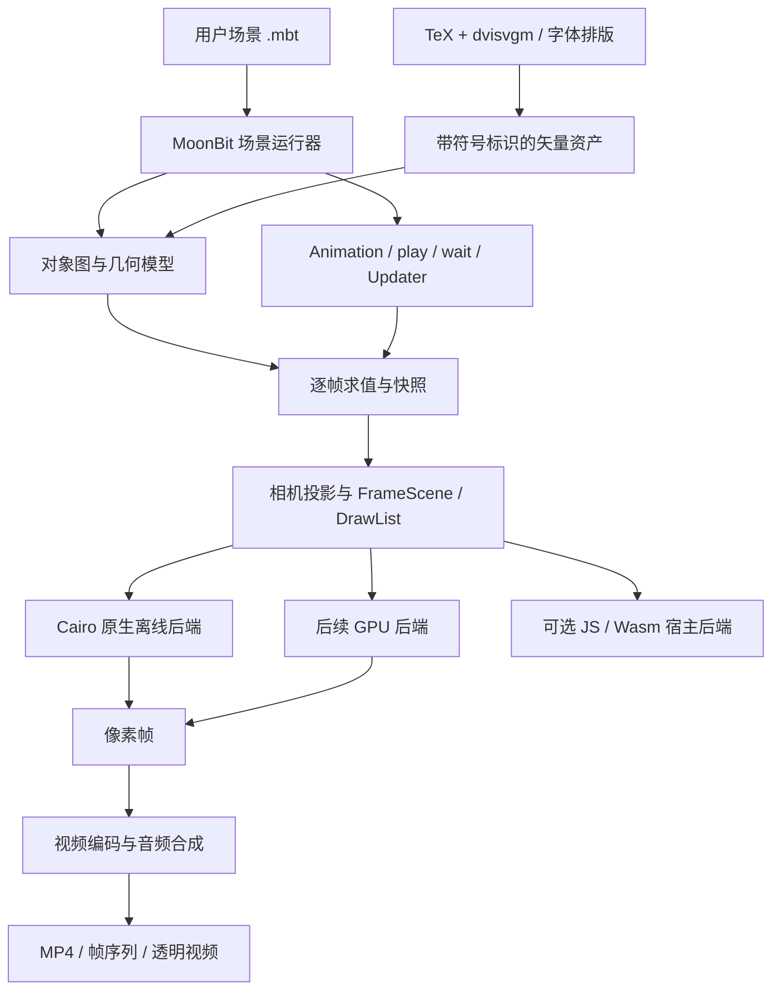

# MoonBit 数学动画引擎实现方案

本文是总体设计方案，调研依据为当前工作区的 Manim CE 源码、MoonBit 官方文档，以及本机 MoonBit 工具链；截至 2026-11-15。二维核心、坐标绘图和语义公式教学已实现，实际可用 API、运行命令与当前限制见 [项目 README](../README.md) 和 [教学开发说明](teaching.zh-CN.md)；本文中其他 API 草图仍是设计，不代表已经交付。

## 1. 产品与实现边界

目标是一个用 MoonBit 编写场景、通过命令行逐帧渲染数学动画并导出视频的引擎。它应当包含可复用的 MoonBit 库、场景运行器、离线渲染器、媒体输出和开发工具。浏览器可以成为一种预览宿主，但不承担引擎的核心语义。

建议以本地 `manim-main` 的 Manim Community Edition 为功能基准。该副本的 `pyproject.toml` 标记版本为 0.22.1；这仅标识本地副本，不代表对上游最新版本的判断。3b1b 自用的 `3b1b/manim` / ManimGL 是另一条分支，需要另行参考其交互与 GPU 表现。

区分三种兼容：

- 概念兼容：Scene、Mobject、VMobject、Animation、Camera、Updater。
- 行为兼容：动画生命周期、对象身份、图形变形、公式匹配、坐标与时间语义。
- 源码兼容：直接执行原有 Python 场景，需要 Python 解释器或一个庞大的语言兼容层，不作为 MoonBit 重实现的前提。

“用 MoonBit 实现”建议定义为：场景、数学算法、几何模型、动画系统、调度和渲染命令生成均由 MoonBit 实现；Cairo、字体排版、TeX 和视频编码使用成熟的外部基础设施。Manim 自身同样依赖这些层。若要求连光栅器、字体布局和视频编码也全部由 MoonBit 从零实现，工作范围会扩大到多个独立项目。

## 2. 总体架构



这里有两个不同的数据边界：

1. `FrameScene` 是后端无关的当前帧视觉状态，包含对象身份、几何、样式、层级、相机等。
2. `DrawList` 是为特定后端准备的紧凑绘制命令。2D 后端可使用路径命令；未来 3D 后端还需要 Mesh、材质、深度和光照命令。

不要让核心模型持有 `cairo_t*`、DOM 节点或某个 GPU API 的对象。也不要强求所有后端通过一个只有 `draw_path` 的接口支持全部能力。通过能力声明明确区分二维填充、裁剪、网格、深度、透明离屏输出等特性。

## 3. 建议模块

| 模块 | MoonBit 中负责的内容 | 外部设施或限制 |
| --- | --- | --- |
| `math` | Vec2/Vec3、矩阵、四元数、复数、插值、数值工具 | 首先用 `Double`；性能优化以测量为准 |
| `geometry` | 贝塞尔路径、子路径、边界、曲线细分、弧长与采样 | 布尔运算可在后期接成熟几何库 |
| `mobject` | 对象身份、组、样式、变换、复制和快照 | 不依赖 Python 类继承 |
| `animation` | Create、Write、Fade、Transform、组合和缓动 | 统一生命周期和属性写入规则 |
| `scene` | add/remove/play/wait、场景注册与上下文 | 第一版使用显式注册 |
| `runtime` | 帧时钟、动画推进、Updater、缓存、事件 | 区分纯时间求值与有状态模拟 |
| `camera` | 世界坐标到画面的映射、移动相机、后续三维投影 | 坐标与线宽单位须固定 |
| `text` | 公式分组、符号选择、字形路径、公式匹配 | TeX/dvisvgm；正文用 Pango 等 |
| `renderer` | 帧描述、绘制协议和后端能力 | 不把外部资源泄露到核心 |
| `backend/cairo` | Cairo 调用封装、颜色与像素格式转换 | C FFI 与少量 C stub |
| `media` | 帧流、编码进程、音轨时间、最终封装 | 先 FFmpeg 进程，后按需求接 libav |
| `cli` | 构建、场景选择、质量、日志、预览和诊断 | 初期直接基于用户 MoonBit 工程运行 |

MoonBit 的 `native`、`js`、`wasm`、`wasm-gc` 是编译目标；Cairo、OpenGL、WebGPU 等是图形渲染后端。两者不是同一层概念。编译成功并不代表目标环境自动具备文件系统、窗口、字体或编码器。

### 视觉风格如何落到引擎能力

用户描述的风格可以做成默认 Theme，避免写死在渲染算法中：

- 黑色或深灰蓝背景、语义化的蓝/黄/绿/红调色板，以及细线和透明填充的默认样式。
- 网格是世界坐标中的程序化几何，根据相机可见区域生成与裁剪；逻辑空间可以无限延伸，无需真的存储无限网格。
- 平滑线条来自正确的曲线几何、亚像素精度、描边连接和抗锯齿；运动平滑还依赖稳定帧时钟与缓动曲线。
- 淡光晕可以作为可选效果，先用较粗、低透明度的多层描边近似，后续再加离屏模糊。大范围 bloom 不是复现该风格的必要条件。
- 公式保留数学排版和符号身份，才能成为可操作的视觉对象。

Theme 负责黑板美学；几何变形、Updater、相机和公式匹配负责讲解能力。两者都需要实现。

## 4. 对象与几何模型

### 4.1 用组合、枚举和 trait 表达对象

固定的内置图形种类可用枚举；渲染器或用户扩展行为适合 trait。避免照搬 Python 的元类、动态属性和多重继承。

建议的数据模型：

```text
NodeId = slot index + generation

Node
  id
  kind: Group | VectorPath | Image | Mesh | Tracker
  local_transform
  style: stroke, fill, opacity, cap, join, fill_rule
  geometry_handle
  children
  z_index + insertion_order
  geometry_revision / style_revision / transform_revision

SceneStore
  nodes
  roots
  updater_registry

Path
  subpaths[]

Subpath
  cubic_segments[]
  closed

CubicBezier
  p0, p1, p2, p3
```

使用稳定 `NodeId`，使对象在动画、组调整和缓存中有一致身份。几何资产与对象实例分离，便于同一个字形路径复用多次。快照可以共享不可变几何，但不能共享会被下一帧直接修改的缓冲区；可采用显式复制或写时复制。

第一版可限制拥有式层级为树，选择集只引用对象而不重复拥有对象。以后若要接近 Manim 的共享组行为，需要明确同一对象出现在多个组时的变换和遍历语义，不能无意中重复更新或重复绘制。

### 4.2 统一贝塞尔路径

二维矢量路径优先以三次贝塞尔曲线作为标准表示：

\[
B(u)=(1-u)^3P_0+3(1-u)^2uP_1+3(1-u)u^2P_2+u^3P_3.
\]

线段可精确升阶为三次曲线；二次贝塞尔也可精确升阶；圆弧通常用三次曲线近似，必须规定误差。SVG 导入还需处理 `M/L/H/V/Q/T/C/S/A/Z`、相对坐标、transform、viewBox、`defs/use` 和填充规则，不能只解析 `path d` 中的几个命令。

几何数据保留世界单位，与像素分辨率分离。需要明确普通描边使用屏幕像素宽度还是世界宽度，以及缩放对象、缩放相机时各如何变化。

### 4.3 精确性影响视觉质量

- 边界框应考虑曲线极值；布局不能只取控制点的平均值。
- 路径包含多个子路径与孔洞，填充须支持 winding / even-odd 语义。
- 函数绘图按误差自适应采样，识别无效值、渐近线与断点，避免把不连续两侧连成直线。
- 非线性映射 `apply_pointwise_function` 前须细分网格线与路径。只变换端点无法把直线正确弯曲，变换贝塞尔控制点也通常不能精确表示原曲线在非线性函数下的像。

这些能力支撑线性代数、复变函数、向量场等可视化，优先级高于装饰效果。

## 5. Transform 是首要算法难点

“正方形变成圆”需要先建立几何对应关系，再做插值。建议在动画开始时执行：

1. 保存源对象起始快照，对目标建立独立快照。
2. 匹配对象与子对象；可使用显式 key、语义标记或几何启发式。
3. 匹配子路径，处理孔洞、闭合状态和轮廓方向。
4. 对闭合轮廓选择合理的起点；必要时反向，减少扭转。
5. 使用 de Casteljau 细分，使对应轮廓的曲线段数一致；缺失轮廓可按策略退化到一点。
6. 对齐样式通道，生成 `PreparedTransform`，供全部帧复用。
7. 每一帧从固定起始快照和目标快照求值；结束时提交最终状态。

对于已经对齐的控制点：

\[
P_i(\alpha)=(1-r(\alpha))P_i^{start}+r(\alpha)P_i^{target}.
\]

`r` 为缓动函数。运动路径还可以采用圆弧等插值。旋转应按角度或四元数插值，不能随意对变换矩阵逐元素插值，否则容易产生塌缩或非预期缩放。

弧长重采样适合改善对应关系，但直接转折线可能改变原轮廓。优先用保持几何形状的贝塞尔细分完成基础对齐，再逐步增加更好的匹配策略。

任意两种拓扑的图形不存在唯一的“正确变形”。这种视觉变形也不自动保证同胚、面积保持或无自交。API 应提供轮廓映射、方向控制和无法匹配时的淡入淡出策略。

`Create` 则需要对路径做部分提取，可结合弧长表与 de Casteljau 分割实现平稳描绘；`Write` 再叠加字形顺序、错峰、描边与填充。简单增加透明度不能替代这两种动画。

## 6. 场景运行与时间语义

### 6.1 先实现 Manim 式顺序执行

第一版建议直接执行 `construct` 风格的场景函数：每次 `play` 推进一段动画、提交结束状态，再执行下一条场景语句。这样用户可以在两次 `play` 之间读取对象位置、计算后续目标或更新数据。

不要在最初就要求把任意 MoonBit 场景编译成可序列化、可任意跳转的完整时间轴。用户闭包、条件分支和有状态 Updater 都会使这件事复杂化。可以先记录播放事件和关键快照，后续为受限的声明式动画增加可重放中间表示。

动画统一生命周期：

```text
prepare -> begin -> sample(alpha) ... -> finish -> cleanup
```

- `prepare/begin` 的源状态必须是动画实际开始时的状态，而不是用户预先构造 Animation 时的状态。
- 同一 `play` 中的多个动画共享帧时钟；这属于时间上的同时发生，无须依赖多线程实现。
- 定义 `Transform` 保留源身份、`ReplacementTransform` 替换场景成员等差异。
- 明确淡出后的移除、创建时的加入、取消时的资源清理。
- 同一对象同一属性的并行动画应报冲突，或使用明确的合成规则；不要依赖遍历顺序覆盖。

### 6.2 确定性帧时钟

帧时间由帧号计算：`t = frame_index × fps_den / fps_num`，支持 60 fps 和 30000/1001 等有理帧率。导出时不能用机器渲染耗时推进动画。

```text
for each scheduled frame:
    determine exact frame time
    sample active animations from their starting snapshots
    evaluate updaters in a defined order
    resolve hierarchy, layout dependencies and world transforms
    build FrameScene / DrawList
    draw pixels
    send frame to encoder with bounded buffering
commit exact end state and perform cleanup
```

规定每段的区间、零时长行为、非整帧时长的量化规则及片段拼接方式。若追求 CE 行为兼容，应参考本地 `_run/frames.py` 的取帧约定，建立专门的兼容用例。动画最终状态通常通过 `finish` 精确提交，不应为每个片段额外重复写一个结束帧。

### 6.3 Updater 决定数学表达力

需要 `ValueTracker`、`always_redraw` 等概念，用于驱动动点、切线、数值标签和向量场。固定更新顺序，例如 tracker/动画属性 → 依赖几何 → 标签与跟随对象；对互相依赖的更新检测循环，或提供显式阶段。

区分两类更新：

- 纯时间更新：对象由 `f(t, trackers)` 决定，可直接求任意时刻。
- 有状态更新：基于 `dt` 积分或累积轨迹，需要固定模拟步长、随机种子、状态快照和重放。

因此不能承诺给任何 Updater 一个时间戳就可以任意 seek。对正在被动画修改的对象，还要规定 Updater 是否暂停，以及恢复时机。第一版宜提供顺序模拟和从头重放，后续再做 checkpoint 加速。

## 7. 公式和文字必须进入对象模型

公式管线建议为：

```text
LaTeX source + template + explicit token groups
  -> latex / xelatex / lualatex
  -> DVI / XDV / PDF
  -> dvisvgm
  -> SVG groups + glyph paths
  -> MoonBit Path objects with token identity
```

数学公式使用 TeX 数学排版，才能处理分式、根号、上下标、伸缩括号和数学间距。仅加载 Computer Modern 字体不能得到相同能力。正文特别是中文要使用有对应字体与 shaping 能力的排版方案，例如 Pango；FreeType 只解决字形等较底层能力。

从第一版公式 API 就保留用户指定的分组或 token key。在完整公式的上下文中排版，通过 SVG 分组等方式恢复 `token -> glyph/path` 映射。不要把公式拆成字符分别排版再拼起来；这样会破坏字距、基线和数学布局。也不能假设输出 SVG 自动携带可恢复的 LaTeX 语义树。

本地 CE 的 `MathTex` 已有用 `dvisvgm:raw` 注入 `<g id=...>` 来标识子串的实现，可作为重点参考。该方案也需要验证复杂宏、分组边界和不同 TeX 引擎的行为；不是对任意 TeX 程序都天然可靠。

建议提供：

- token 选择、着色、定位与独立动画。
- 显式 token 对应关系以及重复 token 的消歧。
- `TransformMatchingTex`：按 token key / 字符串匹配，已匹配部分做 Transform，其余部分按策略加入、移除。
- 缓存 key 包含源码、模板、宏包配置、引擎与字体版本及分组选项。

TeX 编译发生在资产准备阶段，不得每帧调用。动态数字可通过预生成字形和布局缓存实现，避免每次变化重新编译 TeX。未来可以增加 Typst 等提供器，但应明确与 LaTeX 的行为差异。

## 8. 渲染、媒体与 MoonBit FFI

### 8.1 先以 native + Cairo 完成离线闭环

Cairo 提供成熟的二维路径、填充、描边、裁剪和抗锯齿，具有 C API，适合首先实现可对照验证的离线后端。GPU 后端后续解决大规模几何、三维和交互需求。

MoonBit 官方文档给出了 `extern "C"`、`native-stub` 和原生链接配置。建议设置一个窄接口的 C 适配层，负责创建/销毁 surface 与 context、提交紧凑命令和读取像素。所有形状语义、插值、匹配和时间推进仍留在 MoonBit。

FFI 设计要点：

- 基于稳定 ABI 类型传递标量、`Bytes`、`FixedArray` 等；不假设任意 MoonBit struct 都有稳定 C 布局。
- 对缓冲区参数显式规定借用或持有语义，并按当前工具链使用 `#borrow` / `#owned`；不能依赖默认值一直不变。
- 原生资源显式 `close/dispose`，finalizer 作为兜底；裸外部指针不会自动释放 Cairo 资源。
- 按路径或帧批量提交命令，避免逐点跨 FFI 调用；大数组复用，减少逐帧分配。
- Cairo ARGB32 的内存顺序与平台字节序有关，并使用预乘 alpha。写入编码器前明确 stride、行方向、BGRA/RGBA 和 alpha 约定。
- 不把 C 指针带入 `js` / `wasm` 构建；宿主绑定采用独立包与条件配置。

官方文档还提示 native 的调试与发布构建可能走不同实现路径；实验性 `llvm` 目标目前不支持 FFI。首版应锁定工具链并分别验证 debug/release 的 C 库链接，不能把“native”简单等同于始终先生成 C。

### 8.2 流式输出视频

建议首版把规范化的像素帧写入 FFmpeg 子进程 stdin，例如以下概念命令（实际项目需检测编码器是否可用）：

```sh
ffmpeg -f rawvideo -pix_fmt rgba -s:v 1920x1080 -r 60 \
  -i pipe:0 -an -c:v libx264 -pix_fmt yuv420p output.mp4
```

输出侧包含退出码检查、stderr 读取、写入背压、取消、临时文件和成功后的最终重命名。不能只启动编码进程而不检查结果。

1080p RGBA 帧约 8.3 MB，60 fps 原始数据约 498 MB/s。禁止把完整视频全部积存在内存；使用少量缓冲区。静态等待可以复用同一帧图像，但仍须向输出提供正确时长。

普通 H.264/yuv420p 输出不保留透明度；透明背景需要帧序列或支持 alpha 的编码格式。音频按同一逻辑时间轴混音，最后封装；后续可加入字幕、分节和片段缓存。当前本地 CE 使用 PyAV/libav 进行片段编码，采用 FFmpeg 子进程是 MoonBit 首版的工程选择，而非对该源码实现方式的描述。

本机已安装的 core 包存在 `async/process` 管道与进程 API，但带实验性配置。可以在锁定版本后使用；若不希望依赖实验 API，就把进程启动与流式写入封装在小型平台层中。

### 8.3 GPU 与浏览器扩展

GPU 路线需要独立攻克曲线细分或解析覆盖、填充三角化、孔洞、自交、描边连接、裁剪、抗锯齿、透明排序和离屏读回。仅能调用 WebGPU/OpenGL 并不等于已经具备矢量渲染器。

先保留 CPU 上的 `Double` 几何与确定性求值，再为 GPU 转为合适的 packed `Float` buffer。静态几何按 revision 缓存；几何改变时使三角化失效。Cairo 与 GPU 存在光栅差异，跨后端验收应使用可解释容差。

`js` 可接 Canvas/WebGL/WebGPU 宿主，`wasm` / `wasm-gc` 也需要显式的宿主导入与数据传递设计。尤其 wasm-gc 不应假定所有对象都在线性内存中可被 JS/C 直接读取。共享的是核心语义，不是操作系统依赖或完整 FFI 代码。

## 9. 场景 API 与构建体验

以下仅是 API 设计草图，尚未实现或编译验证：

```moonbit
fn square_to_circle(scene : Scene) -> Unit raise {
  let square = scene.square(size=2.0)
  let circle = scene.circle(radius=1.0)
  scene.set_stroke(square, color=Blue, width=3.0)
  scene.set_fill(circle, color=Pink, opacity=0.4)

  scene.play([create(square)], duration=1.0)
  scene.play([transform(square, circle)], duration=2.0)
  scene.play([fade_out(square)], duration=1.0)
  scene.wait(0.5)
}
```

第一版用显式场景注册表 `name -> scene function`；用户工程导入引擎并编译为 native 程序。引擎 CLI 选择场景、分辨率、帧率和输出路径。初期无需自定义语言解析器，也无需模拟 Python 的反射扫描。

后续再封装类似 `moonmanim render --project ./lesson --scene SquareToCircle -qh` 的命令，由工具调用 MoonBit 构建流程。该命令目前只是拟议接口。直接传任意 `.mbt` 文件并动态发现所有场景，需要额外的工程生成、注册或编译协议，不能当作已经具备的能力。

Python 中的 `.animate` 动态调用链可换成类型明确的目标状态 builder，或显式 `move_to/rotate/transform` 动画构造器。优先保留简洁和静态检查能力。

## 10. 分阶段交付与验收

| 阶段 | 交付内容 | 必须能观察到的结果 |
| --- | --- | --- |
| P0 工程打通 | 锁定 MoonBit、Cairo FFI、像素转换、编码与错误处理 | 一个原生程序输出可播放的短视频；无浏览器和 Python 运行时依赖 |
| P1 二维核心 | Path、样式、组、相机、Create/Fade/Transform、play/wait | 正方形描绘、变圆、淡出；不同预览速度不改变导出帧数 |
| P2 数学动画 | Axes/NumberPlane、函数与参数曲线、Tracker/Updater、组合动画 | 动点驱动切线；矩阵变换作用于网格与向量；曲线断点正确 |
| P3 文字与公式 | SVG、TeX 分组、正文 shaping、Write、公式匹配、布局 | 公式符号可独立移动、变色、匹配；中文正文正确显示 |
| P4 制作工作流 | 质量配置、缓存、片段、字幕、音频、移动相机、诊断、预览 | 可反复编辑并增量导出一段完整数学讲解视频 |
| P5 功能扩展 | 图像、表格/矩阵/图、布尔几何、向量场、复平面、复杂变换 | 逐项覆盖选定的 Manim 示例与行为矩阵 |
| P6 三维与 GPU | Mesh、曲面、三维坐标、透视、光照、深度、GPU 窗口与离屏输出 | 旋转曲面和三维数学场景可交互预览并离线导出 |
| P7 兼容与发布 | 跨平台打包、扩展协议、文档、性能、边缘案例 | 有明确的 CE 功能覆盖报告、兼容范围及不支持项 |

P0–P3 是首个有实用价值的数学动画引擎切片，不代表达到整个 `manim-main` 的功能规模。近乎完整的 CE 对等还涉及大量对象类型、平台行为、相机、媒体工作流和历史边缘案例，需要独立维护兼容矩阵。工期应在 P0 完成并测量 FFI、渲染和公式管线后再估算。

最先制作的三个验收场景：

1. 正方形 → 圆：检查路径对齐、插值、样式和视频输出。
2. 曲线上动点与切线：检查坐标、Tracker、Updater 和曲线采样。
3. 带重复符号的公式变换：检查 token 身份、字形分组、匹配和消歧。

## 11. 质量与性能验证

实施时，测试应验证数学与行为契约，而不是只验证程序能运行：

- 几何性质：贝塞尔分割前后路径一致、变换与逆变换、孔洞填充、退化轮廓、端点和边界框。
- 时间与身份：alpha 端点、零时长、并行动画、播放结束清理、源/目标快照隔离、对象替换行为。
- 同一时间/种子得到同一核心状态；有状态模拟验证固定步长重放。
- 固定环境中做关键帧视觉回归；跨平台用容差并固定字体、TeX 和渲染依赖版本。
- 与固定版本 CE 对照选定场景的布局、帧数、对象轨迹和可见行为；不要求所有光栅像素完全相同。
- 基准包括大量路径、网格非线性变换、密集字形和 Updater；记录求值、命令生成、绘制、像素转换与编码的分项耗时。

只有测量证明需要后，才增加全局 SoA 布局、并行几何处理或零拷贝等复杂优化。缓存首先使用资产 key 与显式 revision；对包含外部副作用和闭包的任意场景，不要宣称可以自动安全地计算跨运行内容哈希。

## 12. 源码阅读顺序与资料

当前本地源码正在采用分离的 Manager / run loop / renderer 组织方式，阅读时应沿实际路径，不套用旧版目录：

1. [Scene](../manim-main/manim/scene/scene.py)、[Manager](../manim-main/manim/manager.py)、[run loop](../manim-main/manim/_run/loop.py)、[帧数约定](../manim-main/manim/_run/frames.py)：用户场景如何逐帧运行。
2. [Mobject](../manim-main/manim/mobject/mobject.py)、[VMobject](../manim-main/manim/mobject/types/vectorized_mobject.py)：对象身份、层级、路径与数据对齐。
3. [Animation](../manim-main/manim/animation/animation.py)、[Transform](../manim-main/manim/animation/transform.py)：生命周期与从起始快照插值。
4. [TeX 生成](../manim-main/manim/utils/tex_file_writing.py)、[MathTex](../manim-main/manim/mobject/text/tex_mobject.py)、[公式匹配](../manim-main/manim/animation/transform_matching_parts.py)：符号与矢量路径。
5. [渲染协议](../manim-main/manim/renderer/protocol.py)、[Cairo 绘制](../manim-main/manim/renderer/cairo/rendering.py)、[视频片段编码](../manim-main/manim/scene/video_segment_encoder.py)：后端和媒体分工。

外部资料：

- [MoonBit 官方文档](https://docs.moonbitlang.cn/)
- [MoonBit FFI 与各后端的边界](https://docs.moonbitlang.cn/language/ffi.html)
- [MoonBit 包配置与条件编译](https://docs.moonbitlang.cn/toolchain/moon/package.html)
- [Manim Community Edition](https://github.com/ManimCommunity/manim)
- [3b1b / ManimGL](https://github.com/3b1b/manim)
- [用户提供的中文教程](https://github.com/cai-hust/manim-tutorial-CN)

中文教程可用于收集用户期待的场景与功能，但其中 `manimlib.imports`、`TextMobject`、`GraphScene` 等属于旧版 API，不能直接作为当前 CE 的规格。教程将 `play` 解释为多线程且不阻塞也不应沿用：同一次 play 内动画同时推进，场景的后续语句在这次播放结束后继续执行。

本次仅完成源码与文档调研及架构设计，没有运行 Manim 渲染或验证 Cairo/TeX/FFmpeg 依赖。本机 PATH 中可找到 MoonBit，未找到 `ffmpeg`、`latex`、`dvisvgm`、`pkg-config`；这不等于它们在整台机器上绝对未安装。若参考或移植 CE 源码，应保留对应 MIT 版权与许可信息，具体见本地 `LICENSE` 与 `LICENSE.community`。
